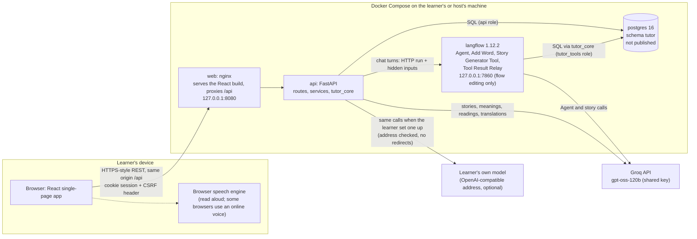
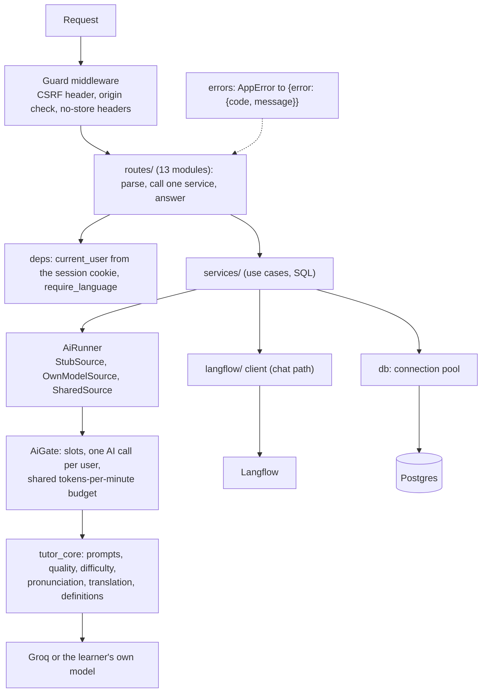

# System Architecture / Deployment Diagram — Language Tutor

*Rewritten 27 October 2026. The first version showed only Langflow, Postgres and Groq; the site now has its own
web server and API, and Langflow is one path among two.*

## 1. Containers and who talks to whom

**Two backend paths on purpose**
- **Agent path** (`POST /api/chat`): the API calls the Langflow flow; the Agent picks a tool; the Tool Result Relay returns the tool's exact output. Used only by the Chat page.
- **Direct path** (vocabulary, sets, stories, practice, readings, translations): the API calls `tutor_core` itself. Faster, deterministic, and it offers controls the Agent tool lacks (kind, topic, difficulty, sets, regenerate).

**Network rules.** Only `web` is reachable from the browser. `api` and `postgres` are not published. Langflow is published on `127.0.0.1:7860` only, because its tools trust the learner id they are given; reaching Langflow's API means reading anyone's words. Langflow's tools connect as the limited role `tutor_tools`.

## 2. Inside the API container

## 3. Notes

- `tutor_core` is a pip package installed in both the `api` and the `langflow` images, so the chat tools and the site run the same rules (word cleaning, story prompts, the quality report).
- `AI_MODE=stub` replaces Groq and Langflow with fixed stand-ins so the whole stack runs offline for tests and demos; `AI_MODE=live` calls them.
- Groq's free-tier rate limit is shared by every learner and by both paths; `AiGate` queues calls (2 slots, 5 s wait) and reserves tokens per minute before a call. A learner's own model skips the shared token budget and has its own limit (10 a minute).
- Passwords are salted and bcrypt-hashed; sessions are JWTs in an httpOnly cookie backed by a `sessions` row that can be revoked; the own-model key is encrypted at rest with `MODEL_KEY_SECRET` and never returned.
- The original design used a local Ollama container with a Hugging Face fallback; it was dropped because local hardware could not run the model. There is no automatic provider fallback.
