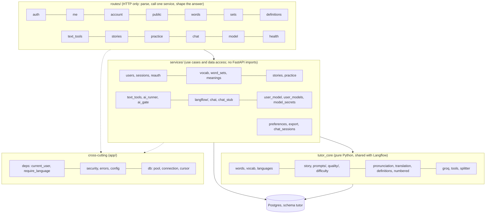
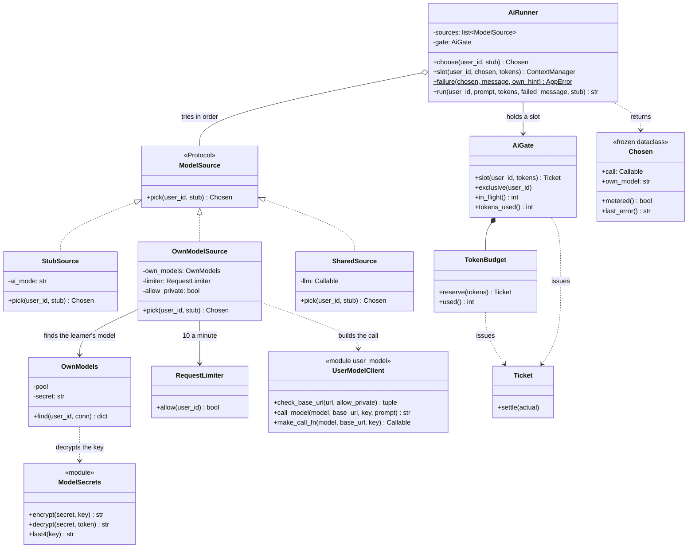
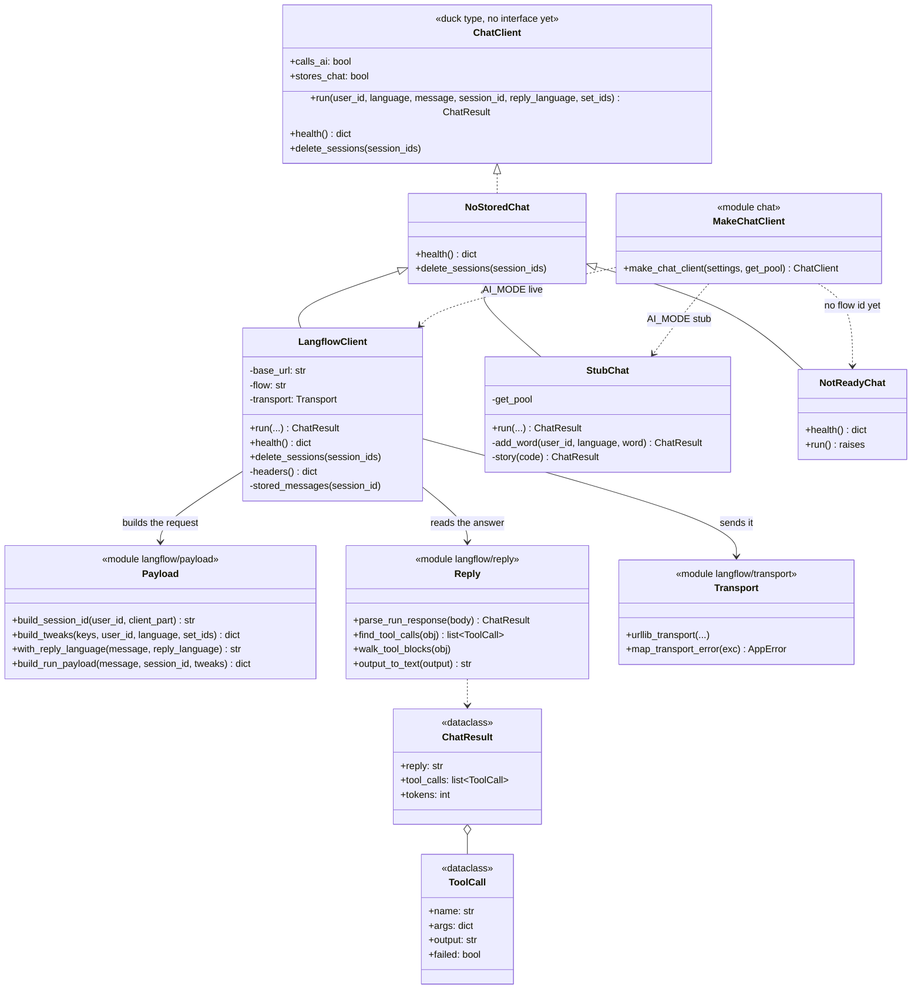
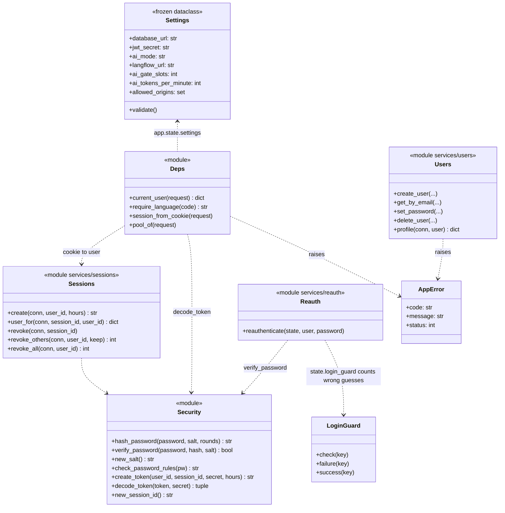
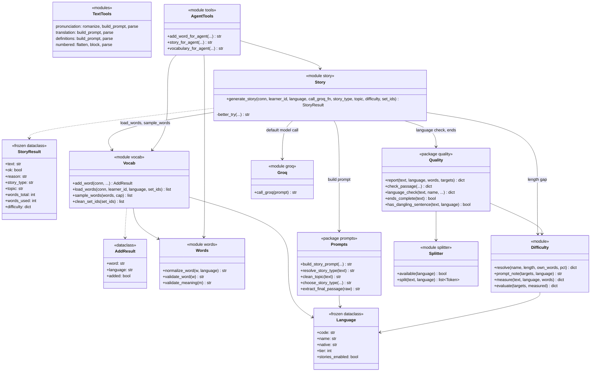
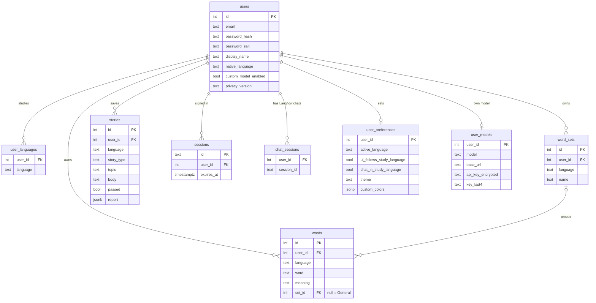

# Class Diagrams — Back End (API, `tutor_core`, Langflow components)

*Updated 27 October 2026, after the SOLID refactor (patch 0030). The diagrams follow the code in `api/app/`,
`tutor_core/tutor_core/` and `custom_components/`. Python has many module-level functions, so a module that is
only functions is drawn as a class with the stereotype `<<module>>`.*

Reading order: 1 layers, 2 model choice (the main design pattern), 3 the chat client, 4 the AI limits and
security, 5 `tutor_core`, 6 who calls what, 7 database. Section 8 records what the diagrams show about where to
split further; each item there is a card in `docs/kanban/cards.json`.

## 1. Layers and the rule between them

**The rule:** a route never touches SQL or a model; a service never imports FastAPI; `tutor_core` never imports
from `api`. `main.py` is the composition root: it builds the `AiGate`, the chat client, the story model and the
limiters once and stores them on `app.state`; routes receive a per-request object built from that state
(`ai_runner_for`, `own_models_for`), which is why tests can swap a part by assigning to `app.state`.

## 2. Choosing which model answers (open/closed, dependency inversion)

The order built by `ai_runner_for` is `StubSource`, `OwnModelSource`, `SharedSource(state.story_llm)`. A new
source (for example a second shared provider) is a new class in that list. The stories route, `meanings.write_missing`
and `text_tools` all go through `AiRunner`; **`routes/chat.py` and `routes/model.py` do not** (see section 8, items B3 and B4).

## 3. The chat path (Agent in Langflow, or a stand-in)

`services/langflow_client.py` is a facade that re-exports the names of the `langflow/` package, so old imports
keep working. The learner's id is never read from the request body: `routes/chat.py` builds the Langflow session
id from the session cookie's user.

## 4. Security, errors and settings

Only the guard middleware in `main.py` (CSRF header, origin check, no-store headers) and `install_error_handlers`
(`AppError` to the `{error: {code, message}}` shape) are applied to every route.

## 5. `tutor_core` (shared by the API and the Langflow tools)

## 6. Which route uses which service

| Route module | Services and helpers it calls |
|---|---|
| `auth` | users, sessions, security, emails, policy |
| `me` | users, preferences |
| `account` | users, sessions, reauth, export, chat_sessions, security, emails |
| `public` | policy, languages |
| `words` | vocab, word_sets |
| `sets` | word_sets |
| `definitions` | meanings, `AiRunner` |
| `text_tools` | text_tools, `AiRunner` |
| `stories` | stories, `AiRunner`, `OwnModels`; `tutor_core` story and quality (**inside the route**) |
| `practice` | practice, stories |
| `chat` | chat client, chat_sessions, preferences, `AiGate` (**inside the route**) |
| `model` | user_models, model_secrets, user_model (**inside the route**) |
| `health` | db, `app.state` health objects |

## 7. Database (schema `tutor`)

Deleting a user cascades to every table above; deleting a set sets `words.set_id` to null (the words move to
General). The Langflow tools connect as the limited role `tutor_tools`: SELECT and INSERT on `words`, INSERT on
`user_languages`, nothing else.

## 8. What these diagrams show about further splits

Findings are ranked by value for easier maintenance. Each has a kanban card (cards "B1" to "B12" in
`docs/kanban/cards.json`). None is built yet; each keeps behaviour unchanged and starts with the existing tests.

| # | Where | What the diagram shows | Proposed split | Principle |
|---|---|---|---|---|
| B1 | `routes/stories.py` (174 lines) | The route holds the whole "make a story" use case (load words, check the minimum, choose the model, generate, report) and also the request models with validators | `services/story_generation.py` for the use case; request models to `schemas`; the route only calls it | S, D |
| B2 | Set filter SQL | The same "all, general or a set id" clause is written three times: `vocab.list_words`, `vocab.words_without_meaning`, `practice._set_clause` | One `word_sets.filter_clause(set_filter)` used by all three | DRY, S |
| B3 | `routes/chat.py` | Holds the chat turn: gate slot, session record, preferences, reply language. The chat client is a duck type read with `getattr(state.chat, "calls_ai")` | `services/chat_turn.py` plus a `ChatClient` Protocol with `calls_ai` and `stores_chat` as real attributes | S, D, L |
| B4 | `routes/model.py` | Holds test, save and remove for the learner's own model, with encryption and the address check inline | `services/model_settings.py`; the route validates the body only | S |
| B5 | `services/user_model.py` (160 lines) | Four jobs in one file: the address guard (SSRF), the pinned connections, the HTTP call, the request limiter | Split into `model_address.py`, `pinned_http.py`, `model_client.py`, `rate_limit.py` | S |
| B6 | `services/vocab.py` (172 lines) | Word CRUD, meaning filling and CSV parsing and bulk insert in one module | `vocab.py` (CRUD), `csv_import.py`; `fill_meanings` and `words_without_meaning` move into `meanings.py` | S, cohesion |
| B7 | `services/practice.py` (192 lines) | Three practice modes in one module | A `practice/` package: `flashcards.py`, `choices.py`, `cloze.py` | S, O |
| B8 | `schemas.py` (204 lines, 29 models) | One file for every response model | A `schemas/` package by area (`user`, `words`, `stories`, `practice`, `system`) with a re-exporting `__init__` | S, I |
| B9 | `tutor_core/story.py` `generate_story` (82 lines, 12 parameters) | Gate, cache, load, prompt, model call, two retry policies in one function; `_better_try` reads the private `difficulty._UNSPACED` | A `StoryCache` class, a `RetryPolicy` for the language and length retries, a `StoryRequest` dataclass for the parameters; make the unspaced-language fact public | S, O, encapsulation |
| B10 | `tutor_core/quality/passage.py` `check_passage` (118 lines, 12 parameters) | The longest function in the repo; one function runs every rule | A list of small rule functions (structure, format, length, vocabulary) combined by a runner | O, S |
| B11 | `custom_components/tool_result_relay.py` and `services/langflow/reply.py` | Both parse a Langflow tool output (`output_to_text`, walking the content blocks), with two slightly different copies | One `tutor_core/tool_output.py` used by both (the other three Langflow components already import `tutor_core`, so the image has it); re-sync the flow | DRY |
| B12 | `security.py` (110 lines) and `difficulty.py` (252 lines) | `security` mixes password hashing, tokens and the login guard; `difficulty` mixes presets, prompt note and measuring | `security/` package (`passwords`, `tokens`, `login_guard`); `difficulty/` package (`presets`, `measure`, `evaluate`) | S |

Not worth splitting (checked): `ai_gate.py` (three small classes that share one lock, one concern),
`main.py` (a composition root should know every part), `policy/` and `emails.py`.
