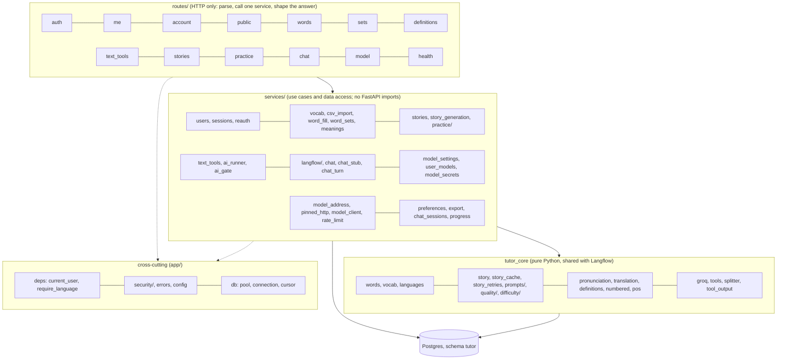
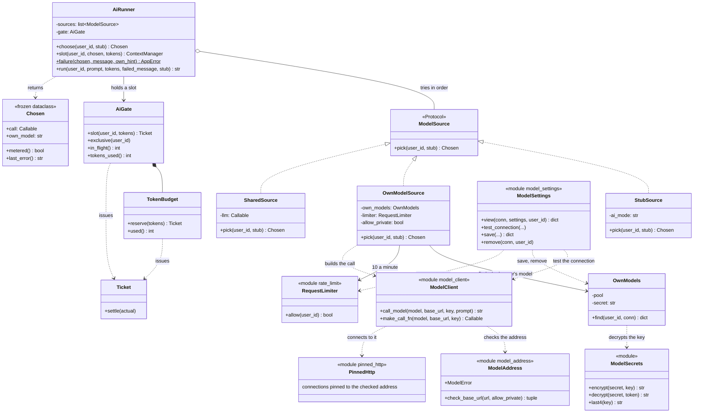
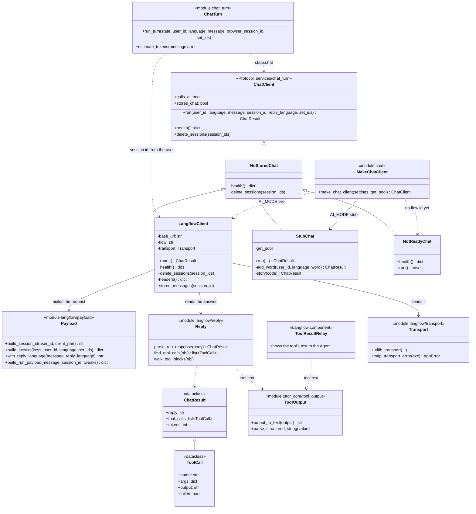
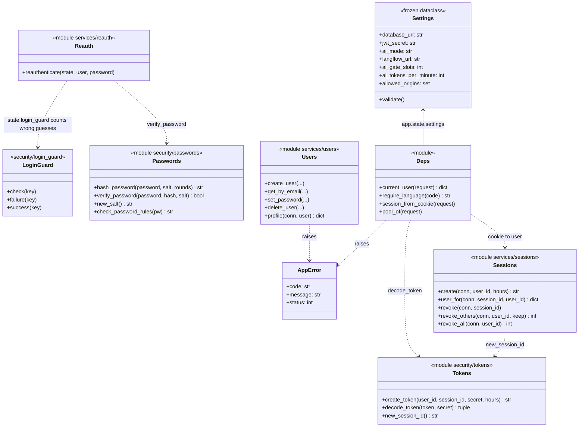
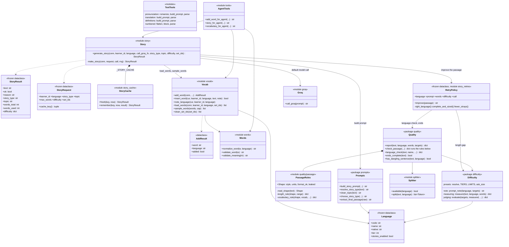
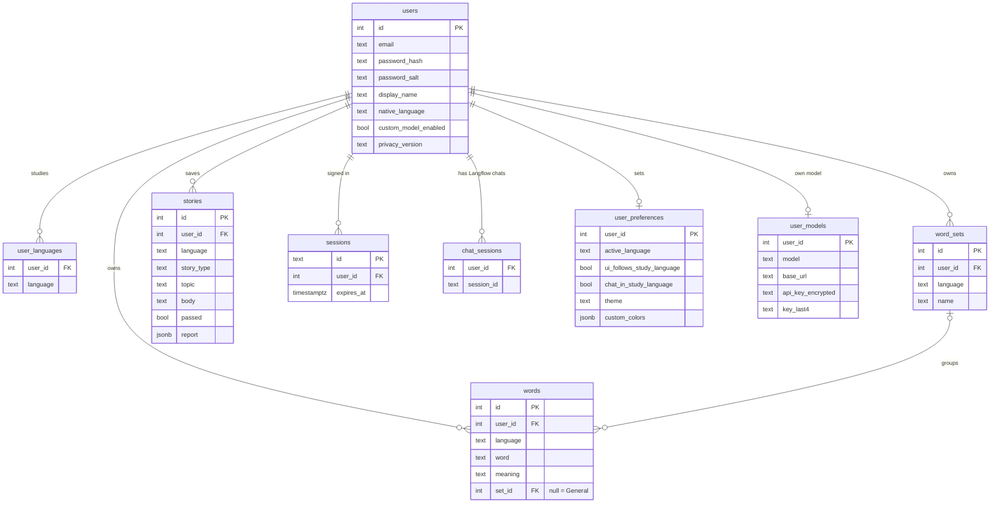

# Class Diagrams — Back End (API, `tutor_core`, Langflow components)

*Updated 31 October 2026, after the SOLID refactor (patch 0030) and the back-end splits B1 to B12 (patches 0030, 0034 and 0037). The diagrams follow the code in `api/app/`,
`tutor_core/tutor_core/` and `custom_components/`. Python has many module-level functions, so a module that is
only functions is drawn as a class with the stereotype `<<module>>`.*

Reading order: 1 layers, 2 model choice (the main design pattern), 3 the chat client, 4 the AI limits and
security, 5 `tutor_core`, 6 who calls what, 7 database. Section 8 records the splits the first version of these
diagrams proposed (cards B1 to B12 in `docs/kanban/cards.json`), which are now built.

## 1. Layers and the rule between them

**The rule:** a route never touches SQL or a model; a service never imports FastAPI; `tutor_core` never imports
from `api`. `main.py` is the composition root: it builds the `AiGate`, the chat client, the story model and the
limiters once and stores them on `app.state`; routes receive a per-request object built from that state
(`ai_runner_for`, `own_models_for`), which is why tests can swap a part by assigning to `app.state`.

## 2. Choosing which model answers (open/closed, dependency inversion)

The order built by `ai_runner_for` is `StubSource`, `OwnModelSource`, `SharedSource(state.story_llm)`. A new
source (for example a second shared provider) is a new class in that list. The stories route (through
`story_generation`), `meanings.write_missing` and `text_tools` all go through `AiRunner`. Chat is the other path:
Langflow, not the API, calls the model, so `chat_turn.run_turn` takes its own slot in the `AiGate`. `routes/model.py`
only checks the request body and calls `ModelSettings`. `services/user_model.py` remains as a facade that re-exports
the four modules above, so old imports keep working.

## 3. The chat path (Agent in Langflow, or a stand-in)

`services/langflow_client.py` is a facade that re-exports the names of the `langflow/` package, so old imports
keep working. The learner's id is never read from the request body: `chat_turn.run_turn` builds the Langflow session
id from the session cookie's user. `routes/chat.py` (46 lines) only checks the request and shapes the answer. The
tool-output parser lives once in `tutor_core.tool_output`: the API reads the Agent's recorded tool calls with it and the
relay component reads the live ones with it, so the two cannot drift apart.

## 4. Security, errors and settings

`security/` is a package (`passwords`, `tokens`, `login_guard`) whose `__init__` re-exports the old names, so
`from app.security import ...` still works. Only the guard middleware in `main.py` (CSRF header, origin check, no-store headers) and `install_error_handlers`
(`AppError` to the `{error: {code, message}}` shape) are applied to every route.

## 5. `tutor_core` (shared by the API and the Langflow tools)

## 6. Which route uses which service

| Route module | Services and helpers it calls |
|---|---|
| `auth` | users, sessions, security, emails, policy |
| `me` | users, preferences |
| `account` | users, sessions, reauth, export, chat_sessions, security, emails |
| `public` | policy, languages |
| `words` | vocab, csv_import, word_fill, word_sets |
| `sets` | word_sets |
| `definitions` | meanings, `AiRunner` |
| `text_tools` | text_tools, `AiRunner` |
| `stories` | story_generation, stories, `AiRunner`, `OwnModels`; `tutor_core` difficulty and prompts (only for the options list) |
| `practice` | practice/ (flashcards, choices, cloze), progress, stories |
| `chat` | chat_turn (which uses the chat client, chat_sessions, preferences and `AiGate`) |
| `model` | model_settings (which uses user_models, model_secrets and model_client) |
| `health` | db, `app.state` health objects |

## 7. Database (schema `tutor`)

Deleting a user cascades to every table above; deleting a set sets `words.set_id` to null (the words move to
General). The Langflow tools connect as the limited role `tutor_tools`: SELECT and INSERT on `words`, INSERT on
`user_languages`, nothing else.

## 8. The splits the first version of these diagrams proposed

The first version of this document (27 October) ranked twelve splits, each a kanban card "B1" to "B12" in
`docs/kanban/cards.json`. All twelve are built, each keeping behaviour unchanged and starting from the existing tests
(API 869 then, 950 now; `tutor_core` 334 then, 365 now).

| # | Where | What the diagram showed | What was done | Principle |
|---|---|---|---|---|
| B1 | `routes/stories.py` | The route held the whole "make a story" use case and the request models | `services/story_generation.py` (generate, save); request models in `schemas`; the route is 60 lines (patch 0034) | S, D |
| B2 | Set filter SQL | The same "all, general or a set id" clause was written three times | One `word_sets.filter_clause(set_filter)` (patch 0034) | DRY, S |
| B3 | `routes/chat.py` | Held the chat turn; the chat client was a duck type read with `getattr` | `services/chat_turn.py` and a `ChatClient` Protocol with `calls_ai` and `stores_chat` as real attributes; the route is 46 lines (patch 0037) | S, D, L |
| B4 | `routes/model.py` | Test, save and remove with encryption and the address check inline | `services/model_settings.py`; the route validates the body only (patch 0037) | S |
| B5 | `services/user_model.py` | Four jobs in one file | `model_address.py`, `pinned_http.py`, `model_client.py`, `rate_limit.py`; `user_model.py` is a facade (patch 0037) | S |
| B6 | `services/vocab.py` | CRUD, meaning filling, CSV parsing and bulk insert in one module | `csv_import.py`, `word_fill.py`; the add-word INSERT is `tutor_core.vocab.insert_word`, used by both add paths (patch 0037) | S, DRY |
| B7 | `services/practice.py` | Three practice modes in one module | `practice/` package: `flashcards.py`, `choices.py`, `cloze.py`, `limits.py` (patch 0037) | S, O |
| B8 | `schemas.py` | One file for every response model | `schemas/` package: `user`, `words`, `stories`, `practice`, `system`; `__init__` re-exports (patch 0037) | S, I |
| B9 | `tutor_core/story.py` `generate_story` | Gate, cache, load, prompt, model call and two retry policies in one function | `StoryRequest`, `StoryCache` (`story_cache.py`), `RetryPolicy` (`story_retries.py`); the unspaced-language fact is public (patch 0037) | S, O |
| B10 | `quality/passage.py` `check_passage` | The longest function in the repo | Small rules (`_read_shape`, `_length_rule`, `_vocabulary_rule`) joined by `check_passage` (patch 0037) | O, S |
| B11 | `tool_result_relay.py` and `langflow/reply.py` | Two copies of the tool-output parser | One `tutor_core/tool_output.py` used by both; the flow was re-synced (patch 0037) | DRY |
| B12 | `security.py` and `difficulty.py` | Each mixed several jobs | `security/` (`passwords`, `tokens`, `login_guard`) and `difficulty/` (`presets`, `note`, `measuring`, `judging`) packages with re-exporting `__init__` (patch 0037) | S |

Not worth splitting (checked): `ai_gate.py` (three small classes that share one lock, one concern),
`main.py` (a composition root should know every part), `policy/` and `emails.py`.
