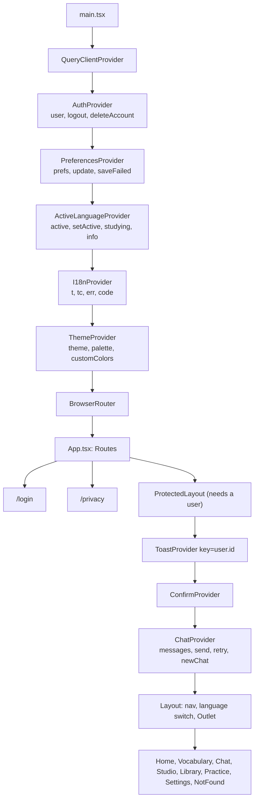
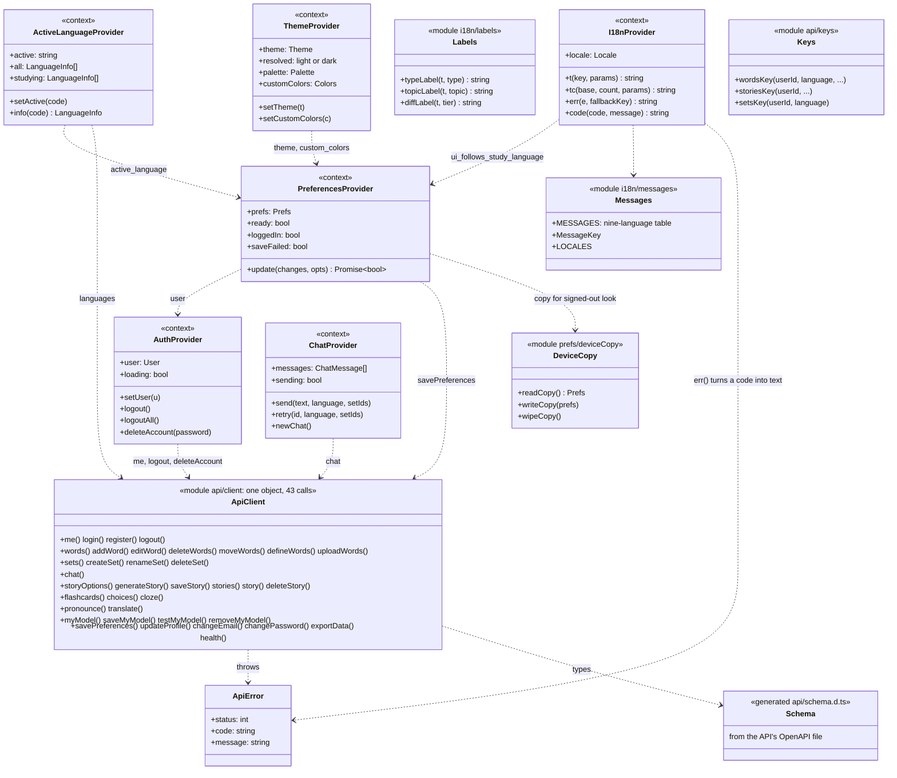
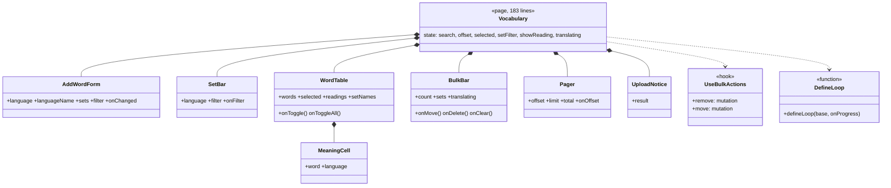
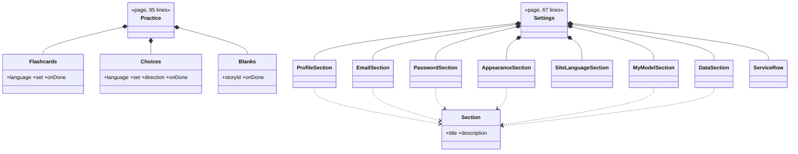
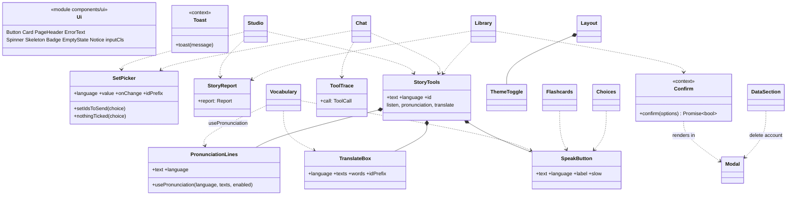
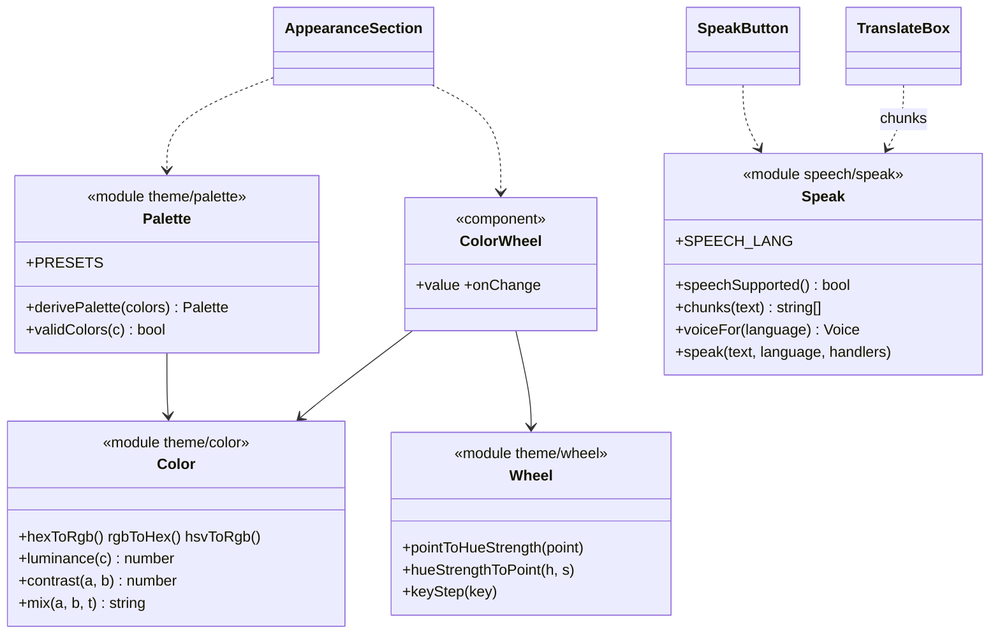

# Class Diagrams — Front End (React, TypeScript, Vite)

*Updated 27 October 2026, after the SOLID refactor (patch 0030). The front end has no classes: it is function
components, hooks and context providers. A **provider** or **module** is drawn as a class with a stereotype, the
props a component takes are its attributes, and `..>` means "uses". Source: `web/src/`.*

Reading order: 1 the shell and providers, 2 the shared API layer, 3 pages and the parts they are built from,
4 shared components, 5 theme, speech and text tools. Section 6 records what the diagrams show about further splits
(cards F1 to F9 in `docs/kanban/cards.json`).

## 1. The shell: providers and routes

The order matters: preferences need the signed-in user, the active language needs the preferences, the site
language needs both, the theme needs the preferences. `ProtectedLayout` is keyed by the user id so a second learner on
the same browser starts with fresh state; the chat lives only in memory, below that key.

## 2. Contexts and the API layer

Every query key starts with the user id (`Keys`), and `AuthProvider` removes all cached data except `"me"` on
sign-out, so one learner's data can never be shown to the next.

## 3. Pages and the parts they are built from

**3a. Vocabulary** (`routes/Vocabulary.tsx` composes `src/vocab/`; the page keeps the state, the parts get props)

**3b. Practice and Settings** (`src/practice/`, `src/settings/`)

**3c. Pages not split yet** (each is one component with local helpers; see section 6)

| Page | Lines | Local pieces | State and requests |
|---|---|---|---|
| `Studio.tsx` | 232 | `customLabel`, `requestedOf`; constants `PRESETS`, `LIMITS`, `CUSTOM` | 10 `useState`, 5 queries and mutations |
| `Login.tsx` | 187 | `PasswordField`, `Field` | two forms (sign in, sign up) |
| `Chat.tsx` | 153 | `SaveStory`, `Waiting` | reads `ChatProvider`; 3 queries and mutations |
| `Privacy.tsx` | 131 | `inline`, `Blocks`, `Th` | policy query |
| `Library.tsx` | 129 | `Opened`, `Row` | 5 queries and mutations |
| `Home.tsx`, `Placeholder.tsx` | 63, 26 | none | none |

## 4. Shared components and what each page uses

## 5. Theme, speech and text helpers (pure modules)

## 6. What these diagrams show about further splits

Findings are ranked by value for easier maintenance. Each has a kanban card (cards "F1" to "F9" in
`docs/kanban/cards.json`). None is built yet; each keeps screens and labels unchanged and keeps the 269 web tests as the safety net.

| # | Where | What the diagram shows | Proposed split | Principle |
|---|---|---|---|---|
| F1 | `api/client.ts` | One object with 43 calls: every page depends on the whole API, and the file grows with every feature | Per-area modules (`api/words.ts`, `stories.ts`, `account.ts`, `practice.ts`, `text.ts`, ...) re-exported as the same `api` object | I, S |
| F2 | `routes/Studio.tsx` (232 lines) | 10 pieces of state, 5 queries and mutations, the difficulty presets and limits, the custom-kind logic and the result view in one component | `studio/OptionsForm`, `studio/DifficultyPicker` (with the presets), `studio/GeneratedStory` (result, save), a `useStoryGeneration` hook | S |
| F3 | `routes/Login.tsx` (187 lines) | Two forms (sign in, sign up) and two field helpers in one page | `auth/LoginForm`, `auth/RegisterForm`, `auth/fields.tsx`; the page chooses the tab | S |
| F4 | `Studio.PRESETS` and `LIMITS` | The three difficulty sizes are written in the page and again in `tutor_core/difficulty.py` | Serve them from `GET /api/stories/options` so the server is the only copy | DRY |
| F5 | `routes/Chat.tsx` (153 lines) | The message list, the composer, the retry and the story-save button in one page | `chat/MessageList`, `chat/Composer`, `chat/SaveStory`; `useChat` stays in the provider | S |
| F6 | Studio and Library | Both show a story's type, topic and difficulty with the same three label helpers and a badge row | One `components/StoryMeta` component | DRY |
| F7 | `i18n/messages.ts` (471 lines) | One table for every page's text, so any page change edits the same file | `i18n/messages/` split by area (`common`, `vocab`, `studio`, `settings`, ...) merged in an index; the compile-time check for a missing translation stays | S, O |
| F8 | `prefs/PreferencesProvider.tsx` (162 lines) | Server sync, debounce and the device copy in one provider | A `useSavedPreferences` hook (debounce and retry) plus the provider that only holds the value | S |
| F9 | `routes/Library.tsx` (129 lines) and `Privacy.tsx` (131 lines) | `Library` holds the list, the row, the opened story and the delete flow; `Privacy` holds a small renderer for the policy blocks | `library/StoryRow`, `library/OpenedStory`; `privacy/PolicyBlocks` | S |

Not worth splitting (checked): the context providers other than preferences (each is under 125 lines with one
reason to change), `components/ui.tsx` (ten tiny primitives that change together), `theme/` (already split into
colour math, palette, wheel and component), and `Settings.tsx` after patch 0030 (67 lines).
