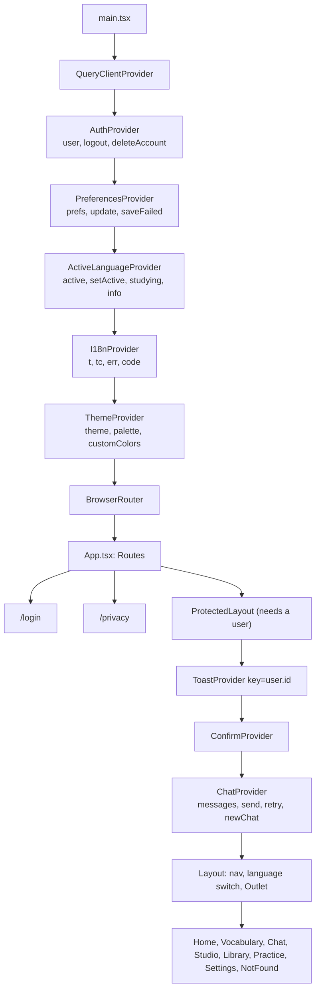
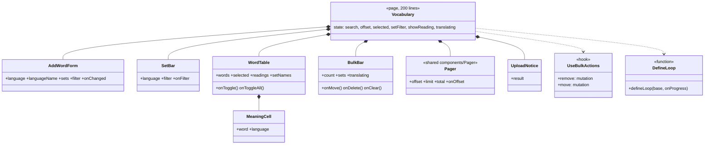
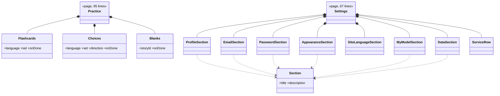
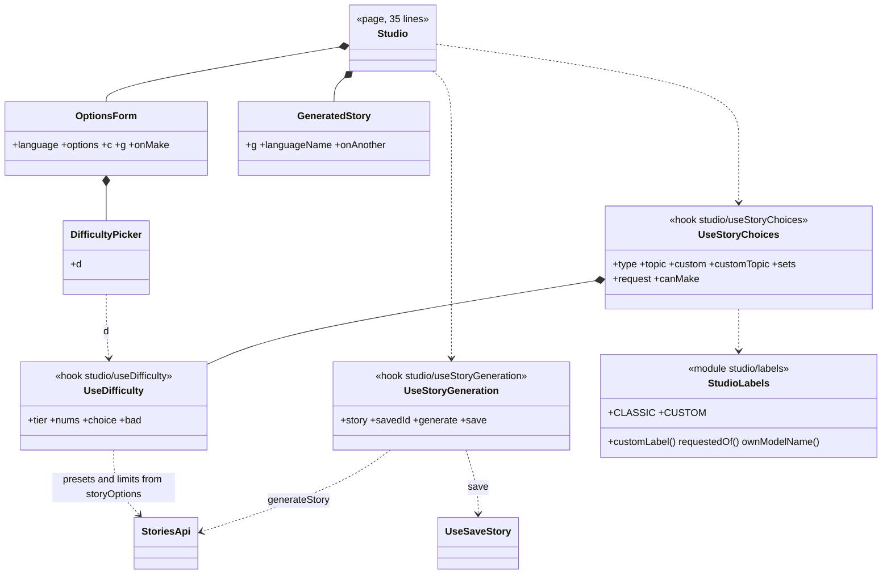
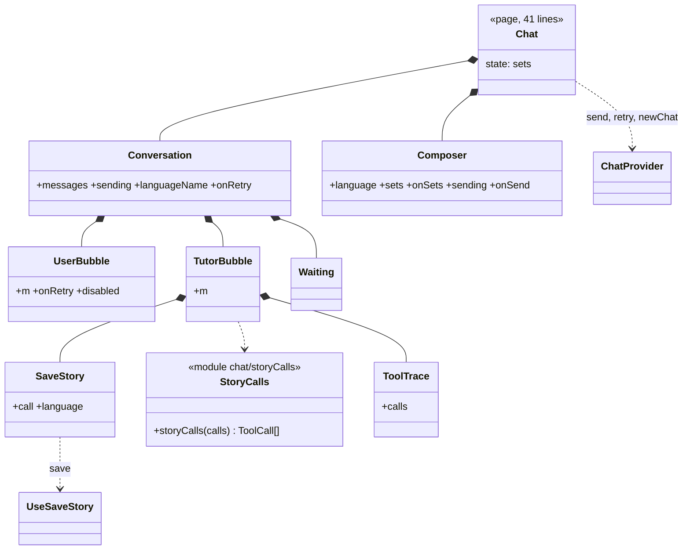
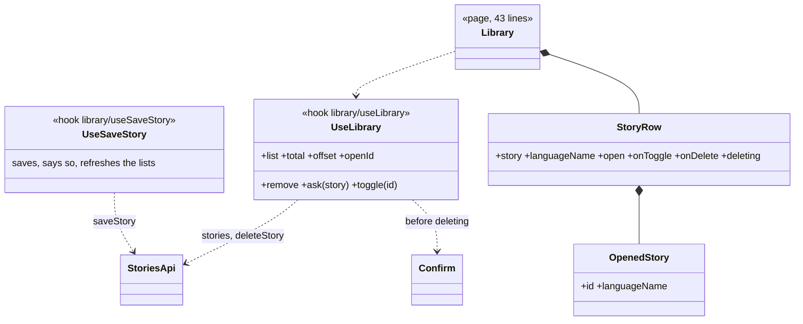
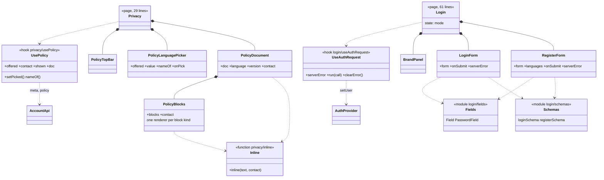
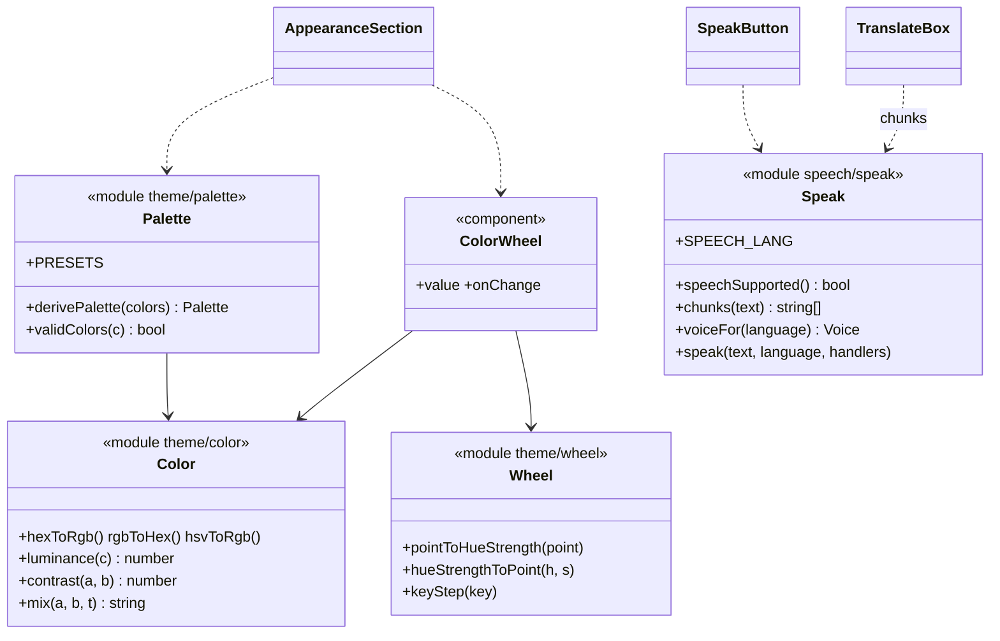

# Class Diagrams — Front End (React, TypeScript, Vite)

*Updated 31 October 2026, after the SOLID refactor (patch 0030) and the front-end splits F1 to F9 (patches 0037 and 0038). The front end has no classes: it is function
components, hooks and context providers. A **provider** or **module** is drawn as a class with a stereotype, the
props a component takes are its attributes, and `..>` means "uses". Source: `web/src/`.*

Reading order: 1 the shell and providers, 2 the shared API layer, 3 pages and the parts they are built from,
4 shared components, 5 theme, speech and text tools. Section 6 records the splits the first version of these diagrams
proposed (cards F1 to F9 in `docs/kanban/cards.json`), which are now built, and what is left.

## 1. The shell: providers and routes

The order matters: preferences need the signed-in user, the active language needs the preferences, the site
language needs both, the theme needs the preferences. `ProtectedLayout` is keyed by the user id so a second learner on
the same browser starts with fresh state; the chat lives only in memory, below that key.

## 2. Contexts and the API layer

```mermaid
classDiagram
    class AuthProvider {
        <<context>>
        +user: User
        +loading: bool
        +setUser(u)
        +logout()
        +logoutAll()
        +deleteAccount(password)
    }
    class PreferencesProvider {
        <<context>>
        +prefs: Prefs
        +ready: bool
        +loggedIn: bool
        +saveFailed: bool
        +update(changes, opts) Promise~bool~
    }
    class SavedPreferences {
        <<hook prefs/useSavedPreferences>>
        +overrides: unsaved changes
        +saveFailed: bool
        +update(changes, opts)
    }
    class DeviceSync {
        <<hooks prefs/deviceSync>>
        +useWriteDeviceCopy(loading, userId, prefs)
        +useFollowOtherTabs(userId)
    }
    class LegacyAdoption {
        <<hook prefs/legacyAdoption>>
        +useLegacyAdoption(user, update)
    }
    class DeviceCopy {
        <<module prefs/deviceCopy>>
        +readCopy() Prefs
        +writeCopy(prefs)
        +wipeCopy()
    }
    class ActiveLanguageProvider {
        <<context>>
        +active: string
        +all: LanguageInfo[]
        +studying: LanguageInfo[]
        +setActive(code)
        +info(code) LanguageInfo
    }
    class I18nProvider {
        <<context>>
        +locale: Locale
        +t(key, params) string
        +tc(base, count, params) string
        +err(e, fallbackKey) string
        +code(code, message) string
    }
    class Messages {
        <<module i18n/messages>>
        +MESSAGES: nine-language table
        +AREAS
        +MessageKey
        +LOCALES
    }
    class Catalog {
        <<15 files in i18n/catalog>>
        shell common errors home vocabulary
        settings chat studio library practice
        report setsAndMeanings readAloud
        pronunciation dialogs
    }
    class Labels {
        <<module i18n/labels>>
        +typeLabel(t, type) string
        +topicLabel(t, topic) string
        +diffLabel(t, tier) string
    }
    class ThemeProvider {
        <<context>>
        +theme: Theme
        +resolved: light or dark
        +palette: Palette
        +customColors: Colors
        +setTheme(t)
        +setCustomColors(c)
    }
    class ChatProvider {
        <<context>>
        +messages: ChatMessage[]
        +sending: bool
        +send(text, language, setIds)
        +retry(id, language, setIds)
        +newChat()
    }
    class ApiClient {
        <<module api/client: composes the areas into one api object>>
        +api
    }
    class AccountApi {
        <<module api/account>>
        +me() login() register() logout() logoutAll() meta() policy()
        +updateProfile() savePreferences() changeEmail() changePassword()
        +deleteAccount() exportData() addLanguage() languages() health()
    }
    class WordsApi {
        <<module api/words>>
        +words() addWord() editWord() deleteWords() uploadWords()
        +sets() createSet() renameSet() deleteSet() moveWords()
        +defineWords() labelWords() partsOfSpeech() starterPacks() addStarterPack()
    }
    class StoriesApi {
        <<module api/stories>>
        +storyOptions() generateStory() saveStory()
        +stories() story() deleteStory()
    }
    class PracticeApi {
        <<module api/practice>>
        +flashcards() choices() dictation() posCards() cloze()
        +recordAnswers() practiceProgress()
    }
    class ChatApi {
        <<module api/chat>>
        +chat()
    }
    class TextApi {
        <<module api/text>>
        +pronounce() translate()
    }
    class ModelApi {
        <<module api/model>>
        +myModel() saveMyModel() testMyModel() removeMyModel()
    }
    class Http {
        <<module api/http>>
        +request(method, path, opts)
        +qs(params)
        +setCurrentUserId(id)
    }
    class ApiError {
        +status: int
        +code: string
        +message: string
    }
    class Keys {
        <<module api/keys>>
        +wordsKey(userId, language, ...)
        +storiesKey(userId, ...)
        +setsKey(userId, language)
    }
    class Schema {
        <<generated api/schema.d.ts>>
        from the API's OpenAPI file
    }

    AuthProvider ..> AccountApi : me, logout, deleteAccount
    PreferencesProvider ..> AuthProvider : user
    PreferencesProvider *-- SavedPreferences : saving
    PreferencesProvider ..> DeviceSync : device copy
    PreferencesProvider ..> LegacyAdoption : old device settings
    SavedPreferences ..> AccountApi : savePreferences
    DeviceSync ..> DeviceCopy : read, write, wipe
    ActiveLanguageProvider ..> PreferencesProvider : active_language
    ActiveLanguageProvider ..> AccountApi : languages
    I18nProvider ..> PreferencesProvider : ui_follows_study_language
    I18nProvider ..> Messages
    Messages *-- Catalog
    ThemeProvider ..> PreferencesProvider : theme, custom_colors
    ChatProvider ..> ChatApi : chat
    ApiClient *-- AccountApi
    ApiClient *-- WordsApi
    ApiClient *-- StoriesApi
    ApiClient *-- PracticeApi
    ApiClient *-- ChatApi
    ApiClient *-- TextApi
    ApiClient *-- ModelApi
    AccountApi ..> Http
    WordsApi ..> Http
    StoriesApi ..> Http
    PracticeApi ..> Http
    ChatApi ..> Http
    TextApi ..> Http
    ModelApi ..> Http
    Http ..> ApiError : throws
    ApiClient ..> Schema : types
    I18nProvider ..> ApiError : err() turns a code into text
```

Every query key starts with the user id (`Keys`), and `AuthProvider` removes all cached data except `"me"` on
sign-out, so one learner's data can never be shown to the next.

The API layer has one module per area that a page uses (`api/account.ts`, `words.ts`, `stories.ts`, `practice.ts`,
`chat.ts`, `text.ts`, `model.ts`) over one shared `request` in `api/http.ts`; `api/client.ts` only puts them together
so pages still import `api` from one place. A page that needs a new call adds it to its own area. The preferences
provider only merges defaults, the account's values and unsaved changes; saving, the device copy and the one-time
adoption of old device settings are one hook each.

## 3. Pages and the parts they are built from

**3a. Vocabulary** (`routes/Vocabulary.tsx` composes `src/vocab/`; the page keeps the state, the parts get props)

**3b. Practice and Settings** (`src/practice/`, `src/settings/`)

**3c. Story Studio** (`routes/Studio.tsx` composes `src/studio/`; patch 0037)

The three difficulty sizes and the limits are no longer written in the page: `GET /stories/options` sends them
from `tutor_core.difficulty`, and `useDifficulty` reads them from there.

**3d. Chat** (`routes/Chat.tsx` composes `src/chat/`; patch 0038)

`Chat` holds only the set choice and passes the sets ticked *now* to both Send and Try again.

**3e. Library** (`routes/Library.tsx` composes `src/library/`; patch 0038)

**3f. Privacy and Login** (`src/privacy/`, `src/login/`; patch 0038)

The form state of Login lives in the page (`useLoginForm`, `useRegisterForm`), so what was typed survives switching
tabs; each form only draws it. Pages still in one piece: `Home.tsx` (63 lines) and `Placeholder.tsx` (26).

## 4. Shared components and what each page uses

```mermaid
classDiagram
    class Ui {
        <<module components/ui>>
        Button Card PageHeader ErrorText
        Spinner Skeleton Badge EmptyState Notice inputCls
    }
    class SetPicker {
        +language +value +onChange +idPrefix
        +setIdsToSend(choice)
        +nothingTicked(choice)
    }
    class StoryReport {
        +report: Report
    }
    class StoryTools {
        +text +language +id
        listen, pronunciation, translate
    }
    class SpeakButton {
        +text +language +label +slow
    }
    class TranslateBox {
        +language +texts +words +idPrefix
    }
    class PronunciationLines {
        +text +language
        +usePronunciation(language, texts, enabled)
    }
    class ToolTrace {
        +call: ToolCall
    }
    class StoryMeta {
        +kind +topic +difficulty
        badges for a story
    }
    class PracticeLink {
        +storyId
    }
    class Pager {
        +offset +limit +total +onOffset
    }
    class Modal
    class Confirm {
        <<context>>
        +confirm(options) Promise~bool~
    }
    class Toast {
        <<context>>
        +toast(message)
    }
    class Layout
    class ThemeToggle

    OptionsForm ..> SetPicker
    Composer ..> SetPicker
    GeneratedStory ..> StoryReport
    GeneratedStory ..> StoryTools
    GeneratedStory ..> StoryMeta
    GeneratedStory ..> PracticeLink
    OpenedStory ..> StoryReport
    OpenedStory ..> StoryTools
    StoryRow ..> StoryMeta
    StoryRow ..> PracticeLink
    TutorBubble ..> StoryTools
    TutorBubble ..> ToolTrace
    UseLibrary ..> Confirm
    Vocabulary ..> Pager
    Library ..> Pager
    Vocabulary ..> TranslateBox
    Vocabulary ..> PronunciationLines : usePronunciation
    StoryTools *-- PronunciationLines
    StoryTools *-- TranslateBox
    StoryTools *-- SpeakButton
    Vocabulary ..> SpeakButton
    Flashcards ..> SpeakButton
    Choices ..> SpeakButton
    Confirm ..> Modal : renders in
    Layout *-- ThemeToggle
    DataSection ..> Modal : delete account
```

## 5. Theme, speech and text helpers (pure modules)

## 6. The splits the first version of these diagrams proposed

The first version of this document (27 October) ranked nine splits, each a kanban card "F1" to "F9" in
`docs/kanban/cards.json`. All nine are built and tested: each kept screens and labels unchanged, and the web tests
(269 then, 330 now) were the safety net.

| # | Where | What the diagram showed | What was done | Principle |
|---|---|---|---|---|
| F1 | `api/client.ts` | One object with 43 calls: every page depends on the whole API | `api/account.ts`, `words.ts`, `stories.ts`, `practice.ts`, `chat.ts`, `text.ts`, `model.ts` over one `api/http.ts`; `client.ts` composes the same `api` object (patch 0037) | I, S |
| F2 | `routes/Studio.tsx` (232 lines) | 10 pieces of state, 5 queries and mutations, presets, custom-kind logic and the result in one component | `studio/OptionsForm`, `DifficultyPicker`, `GeneratedStory`, and the hooks `useStoryChoices`, `useDifficulty`, `useStoryGeneration`; the page is 35 lines (patch 0037) | S |
| F3 | `routes/Login.tsx` (187 lines) | Two forms and two field helpers in one page | `login/LoginForm`, `RegisterForm`, `fields`, `schemas`, `BrandPanel`, `useAuthRequest`; the page is 61 lines (patch 0038) | S |
| F4 | `Studio.PRESETS` and `LIMITS` | The three difficulty sizes were written in the page and again in `tutor_core/difficulty` | `GET /stories/options` sends them; the server is the only copy (patch 0037) | DRY |
| F5 | `routes/Chat.tsx` (153 lines) | Message list, composer, retry and save button in one page | `chat/Conversation`, `Bubbles`, `Composer`, `Waiting`, `SaveStory`, `storyCalls`; the page is 41 lines (patch 0038) | S |
| F6 | Studio and Library | Both drew a story's kind, topic and difficulty with the same helpers | `components/StoryMeta` (patch 0038) | DRY |
| F7 | `i18n/messages.ts` (471 lines) | One table for every page's text | 15 files in `i18n/catalog/`, merged in `messages.ts`; the nine-strings check applies in each file and a test checks a key lives in one area (patch 0038) | S, O |
| F8 | `prefs/PreferencesProvider.tsx` (162 lines) | Server sync, debounce and the device copy in one provider | `useSavedPreferences`, `deviceSync`, `legacyAdoption`; the provider only merges (patch 0038) | S |
| F9 | `routes/Library.tsx` and `Privacy.tsx` | `Library` held the list, the row, the opened story and the delete flow; `Privacy` a block renderer | `library/StoryRow`, `OpenedStory`, `useLibrary`; `privacy/PolicyBlocks`, `PolicyDocument`, `usePolicy` and three more (patch 0038) | S |

Three copies were also removed on the way (patch 0038): the Previous/Next pager (now `components/Pager`, used by
Vocabulary and Library), the Practise link (`components/PracticeLink`) and the save-a-story mutation
(`library/useSaveStory`, used by Studio and Chat).

Not worth splitting (checked): the context providers other than preferences (each is under 125 lines with one
reason to change), `components/ui.tsx` (ten tiny primitives that change together), `theme/` (already split into
colour math, palette, wheel and component), and `Settings.tsx` after patch 0030 (69 lines). The largest page now
is `Vocabulary.tsx` (200 lines), which only composes parts and keeps the page's state; it would be the next to look at
if it grows again.
