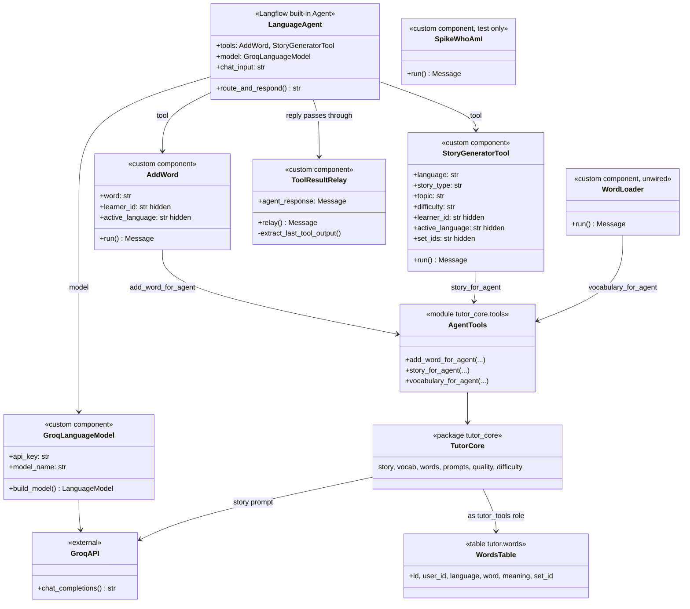

# Class Diagrams — Index, and the Langflow Components

*Updated 27 October 2026. The first version ("rough, by design") covered only the Langflow side. The site now has a
Python back end and a React front end, so the class diagrams are split into three files:*

| File | Covers |
|---|---|
| [`class-diagram-backend.md`](class-diagram-backend.md) | the FastAPI service, `tutor_core`, the model-choice classes, the chat client, security, the database, and the list of further back-end splits |
| [`class-diagram-frontend.md`](class-diagram-frontend.md) | the React shell, contexts, the API layer, pages and their parts, shared components, and the list of further front-end splits |
| this file | the Langflow components and how they reach `tutor_core` |

## Langflow components (`custom_components/`)

**Notes**
- Each component is thin: Langflow's component code only collects inputs and calls one `tutor_core.tools` function, so the same rules run in chat and on the site. The component code is copied into `flows/language-tutor.json`; `scripts/sync_flow_nodes.py --check` must print "in step".
- `StoryGeneratorTool` is one component because Langflow's Tool Mode returns only a component's own output.
- The hidden inputs (`learner_id`, `active_language`, `set_ids`) are set by the API per request through the run's tweaks; the Agent cannot see or change them.
- The old Step 8 canvas pipeline was deleted on 18 October 2026. `WordLoader` remains, unwired, for debugging; `SpikeWhoAmI` is the M0 spike that proved per-request inputs stay separate.
- Known duplication: `ToolResultRelay` and `api/app/services/langflow/reply.py` each parse a tool's recorded output (card B11).
