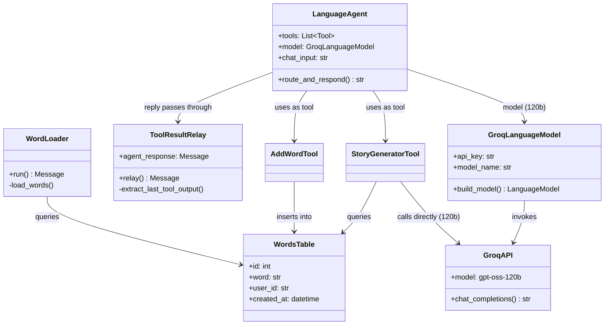

# Rough Class Diagram — Language Tutor with Langflow

**Notes**
- "Rough" by design — not a full implementation-ready class model.
- `StoryGeneratorTool` is one component because Langflow's Tool Mode returns only a component's own
  output. It takes the language and, optionally, a story type and a topic. The old Step 8 canvas
  pipeline (`UploadWordFile`, `StoryPromptBuilder`, `story_guard`, `FinalPassageExtractor`) was deleted
  on 18 October 2026; `WordLoader` remains, unwired, for debugging.
