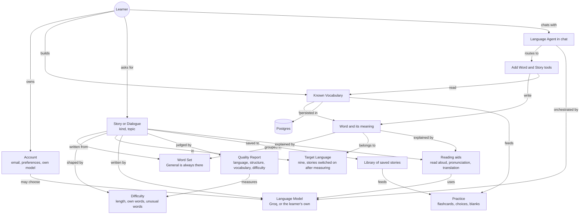

# High-Level Concept Map — Language Tutor

*Rewritten 27 October 2026 to include accounts, word sets, difficulty, the quality report and the text tools.*

**Notes**
- A concept view, not a component view: it shows how the *ideas* relate, independent of code.
- The recurring theme is still the learner's own vocabulary: stories, practice, readings and the chat all start from it, and the **set** lets the learner narrow it.
- The language model appears in three roles: orchestrating the chat, writing stories and text aids, and (optionally) the learner's own model replacing the shared one.
- The **quality report** is what separates this site from "ask a chatbot for a story": every story is measured against the learner's own words and the difficulty asked for, and shown honestly.
