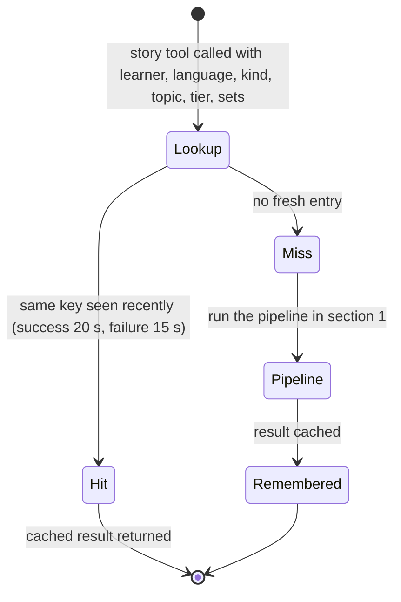

# State Diagram — Story Request Lifecycle

*Rewritten 27 October 2026. The story request now has two entrances (Story Studio through the API, and the chat
tool through Langflow) that share one pipeline, `tutor_core.story.generate_story`.*

## 1. One story, from request to answer

```mermaid
stateDiagram-v2
    [*] --> Received: Studio "Make a story" or the Agent calls the story tool
    Received --> Rejected: language not switched on, bad kind or topic, negative set id
    Received --> LoadingWords
    LoadingWords --> TooFewWords: Studio needs 5 words (any list size for the chat tool)
    LoadingWords --> EmptyList: no words at all (chat tool message)
    LoadingWords --> ChoosingModel: enough words
    ChoosingModel --> Queued: AiRunner picks stub, the learner's own model, or the shared model
    Queued --> Busy: no free slot in 5 s or token budget used up (HTTP 429, try again)
    Queued --> Generating: slot held, tokens reserved
    Generating --> OwnModelFailed: the learner's own model failed (reason shown, no silent fallback)
    Generating --> Failed: error, timeout or empty passage
    Generating --> Extracting: text returned
    Extracting --> LanguageRetry: not in the requested language (not English)
    LanguageRetry --> ShapeCheck: ask once more, keep the second if it has text
    Extracting --> ShapeCheck: language fine
    ShapeCheck --> BetterTry: cut off, dangling ending, or far from the length asked (with a tier)
    BetterTry --> Reporting: asked once more; the closer story is kept
    ShapeCheck --> Reporting: shape fine
    Reporting --> Delivered: quality report (language, structure, vocabulary, difficulty) attached
    Failed --> Delivered: fixed fallback message (chat tool caches it 15 s)
    EmptyList --> Delivered: "add words first"
    TooFewWords --> Delivered: error shown
    Rejected --> Delivered: error shown
    Busy --> Delivered: error shown
    OwnModelFailed --> Delivered: error shown with how to go back to the shared model
    Delivered --> Saved: learner presses Save (report is rebuilt on the server)
    Delivered --> [*]
    Saved --> [*]
```

## 2. The chat tool's cache

**Notes**
- Studio calls the pipeline with the cache off (every press makes a new story); the chat tool leaves it on so an Agent that calls the tool twice in one turn during a rate-limit burst does not pay twice.
- `call_groq` retries HTTP 429 (backoff 1.5 s, up to 3 attempts); other errors are not retried. The two "asked once more" steps (wrong language, cut off or off-length) can add one more model call per story, and the report measures whichever story is returned.
- Failures are cached briefly for the chat tool only; the Studio shows the failure and the learner presses again.
- Code: `tutor_core/story.py` (`generate_story`, `_better_try`), `api/app/routes/stories.py` (`generate`), `api/app/services/ai_runner.py` (`AiRunner`), `api/app/services/ai_gate.py` (`AiGate`), tests in `tutor_core/tests` and `api/tests`.
