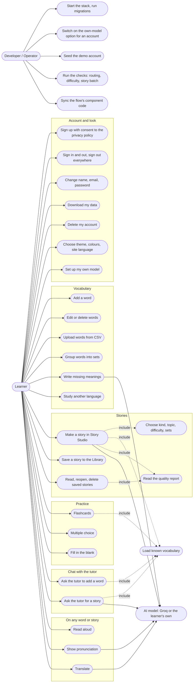

# Use Case Diagram — Language Tutor

*Rewritten 27 October 2026. The first version had one learner chatting and one admin seeding a CSV; the site now
has accounts, a vocabulary manager, story tools and practice.*

**Notes**
- *Learner* is the day-to-day actor; *Operator* does the things the site does not expose (start-up, the own-model switch, seeding, live checks).
- The AI model is shown as a secondary actor: five use cases send text to it (meanings, stories, chat stories, IPA readings, translations). Chinese, Japanese and Korean readings come from libraries and do not.
- "Load known vocabulary" is an `<<include>>` because stories, flashcards and the chat all depend on the learner's own word list.
