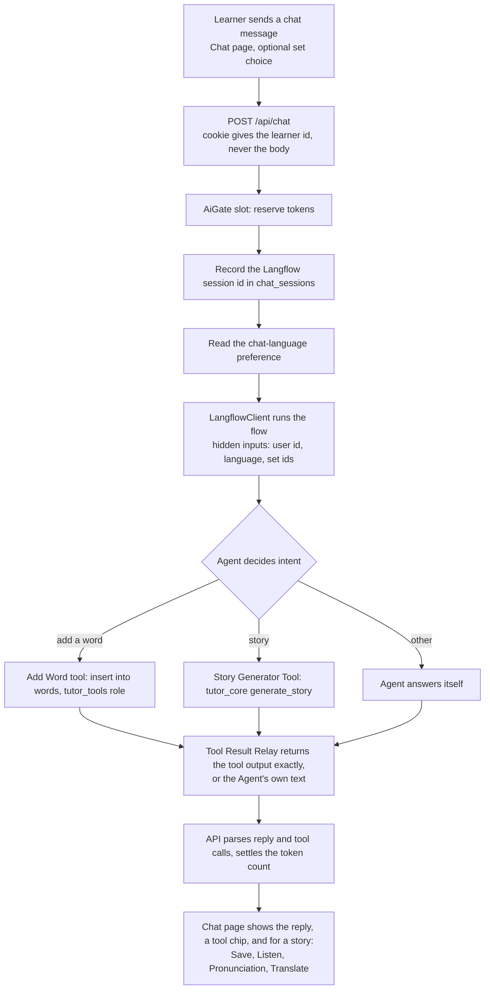
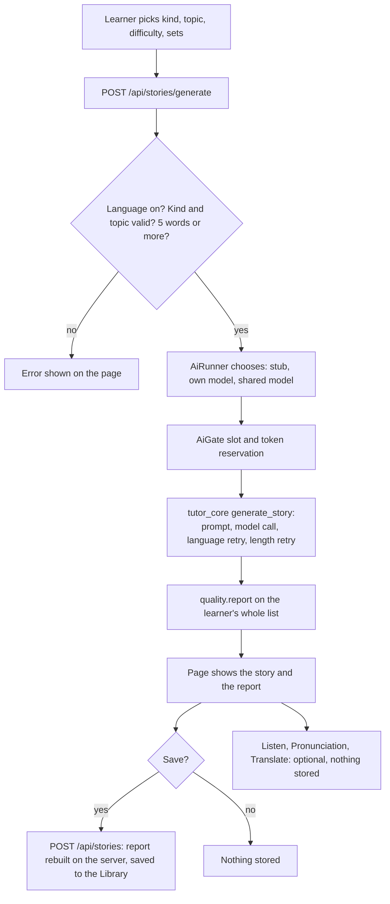
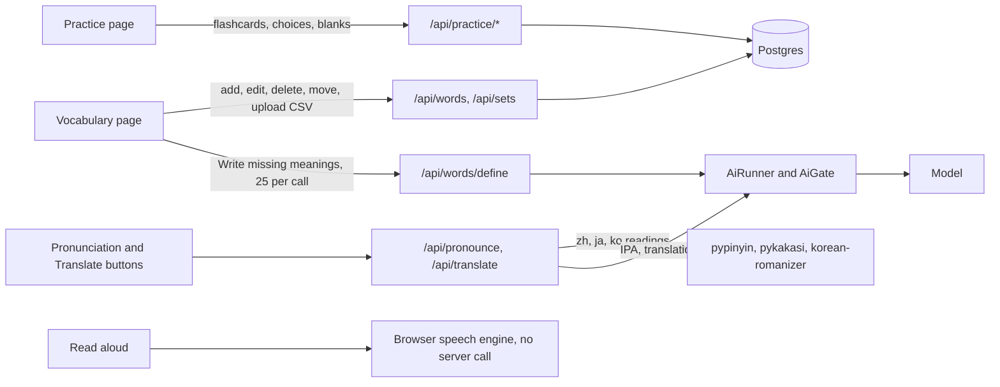

# Workflow Diagram — Language Tutor

*Rewritten 27 October 2026. Two workflows now exist: a chat message through the Langflow Agent, and the direct
requests the pages make.*

## 1. A chat message (Agent path)

## 2. A story from Story Studio (direct path)

## 3. Words, practice and text tools (direct path)

**Notes**
- The Agent path exists so the chat can add words and write stories in conversation; every other feature uses the direct path because it is faster and gives exact controls.
- The "vocabulary empty" guard (Story 5) and the Tool Result Relay (Step 9 fix) still apply on the chat path; the Studio has its own 5-word minimum.
- Nothing from reading, pronunciation or translation is stored; meanings are stored only when the learner asks for them to be written.
